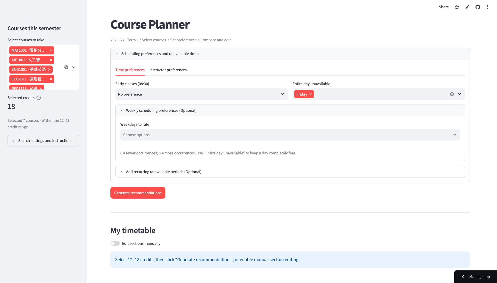
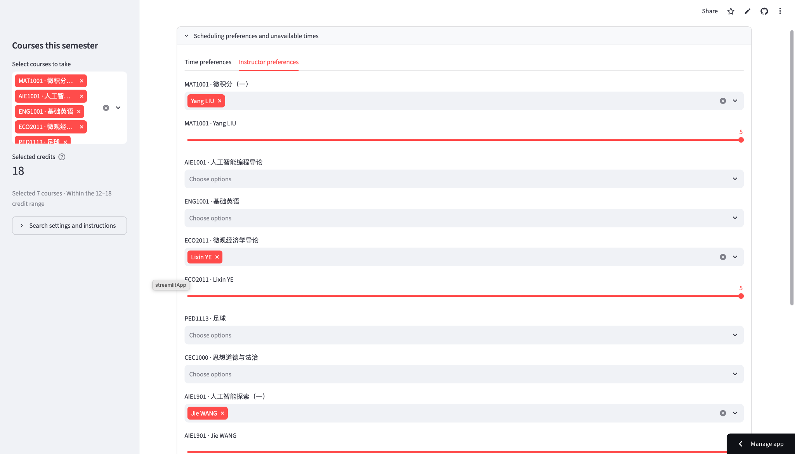
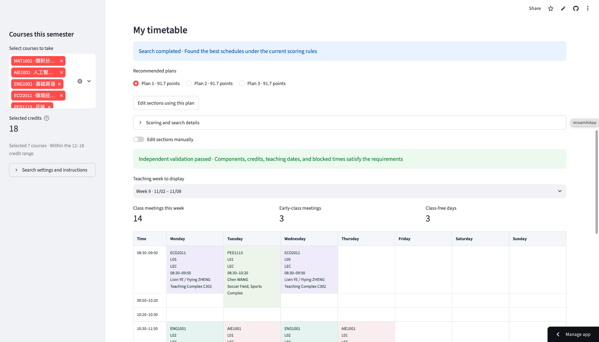

# Course Schedule Optimizer

A Python and Streamlit application for planning CUHK-Shenzhen course schedules under credit requirements, timetable constraints, and personal preferences. The current working version is **v3.0.1**.

## Live demo

**[Open Course Schedule Optimizer](https://course-schedule-optimizer-ovxp4wudvftnxqtoh6dnyn.streamlit.app)**

Select courses, set preferences and unavailable times, then generate and compare recommended timetables. No local installation is required. The app uses a static course-data snapshot and does not enroll courses in SIS.

Choose **2026-27 Term 1** or **2026-27 Term 2** in the sidebar before selecting courses. The public demo may still run an older version until v3.0.1 is deployed.

## Screenshots

### 1. Course selection and time preferences

Select courses, review credit totals, and configure early-class preferences and unavailable weekdays.



### 2. Instructor preferences

Choose instructors for each course and rate preferences from 0 to 5.



### 3. Recommended schedules and independent validation

Compare recommended plans, review validation results, and preview the weekly timetable.



## Quick start

Use Python 3.10 or later. Run these commands from the project root:

```bash
python3 -m pip install -r requirements.txt
python3 -m streamlit run app.py
```

The core optimizer and command-line checker use the Python standard library:

```bash
python3 cli.py examples/request.json > result.json
python3 cli.py --check result.json
python3 -m unittest tests.test_optimizer -v
```

Run UI regression checks after installing the dependencies:

```bash
python3 tests/test_ui.py
```

## Cloud deployment

The live app is deployed with Streamlit Community Cloud:

| Setting | Value |
| --- | --- |
| Repository | `zhenjiapan/course-schedule-optimizer` |
| Branch | `main` |
| Main file path | `app.py` |
| Dependencies | Root `requirements.txt` |
| Course database | `data/term1_2026_2027.sqlite` |

## Features

- Course selection with credit validation and date-aware conflict detection
- Preferences for early classes, weekdays, and instructors
- Backtracking and branch-and-bound search for up to three recommendations
- An independent feasibility checker
- Manual section changes, weekly timetable previews, and CSV/JSON export

## Repository layout

| Path | Purpose |
| --- | --- |
| `app.py` | Streamlit interface |
| `model.py` | Read-only database adapter and input structures |
| `optimizer.py` | Search and preference scoring |
| `checker.py` | Independent schedule validation |
| `timetable.py` | Weekly timetable rendering |
| `cli.py` | Command-line optimization and validation |
| `query_courses.py` | Queries against the full course database |
| `data/` | Current databases |
| `examples/` | Request and reference result JSON files |
| `tests/` | Core and UI regression checks |
| `docs/` | Usage, scoring model, and database documentation |
| `archive/` | Historical v1.0.0, v2.0.0, and v2.0.1 versions |

## Data

`data/term1_2026_2027.sqlite` is a multi-term dataset despite its historical filename. This copy contains 499 courses, 1,700 sections, and 1,742 meeting records: 1,476 sections belong to Term 1 and 224 verified sections belong to Term 2. The app offers a semester selector; the CLI defaults to Term 1 for compatibility. Add `"term": "2026-27 Term 2"` to a CLI request to plan Term 2. `load_catalog(term="2026-27 Term 2")` and `get_schedule(code, term="2026-27 Term 2")` also support direct queries. AIE1901 has no Term 2 offering in the SIS catalog at the time of verification.

The adapter preserves the CHI1000 Lecture-only correction without modifying the source database. Sections with missing teaching dates or times are excluded from planning and reported as warnings; their course/component requirements remain in place. Courses with no usable section for a required component cannot be automatically scheduled.

The November 9, 2026 database refresh added the completed F-, G-, and H-prefix SIS collections. The November 13 release adds the Term 2 records and semester selection. Example outputs are preserved reference files, not newly generated results. The database guide and collection notes in `docs/` document the source history; executable paths resolve relative to the source file.

## Model and limitations

See [usage and scoring](docs/usage-and-model.md) for the objective, hard constraints, timeout behavior, and manual selection workflow, and [database guide](docs/database-guide.md) for source data details.

An optimal status applies only to the supplied candidate data, constraints, and objective. Timed-out results are not certified optimal. The app does not register courses in the university enrollment system and cannot verify prerequisites or section bindings absent from the data.

## Tests and version history

[](https://github.com/zhenjiapan/course-schedule-optimizer/actions/workflows/core-tests.yml)

GitHub Actions runs the core test suite on Python 3.10 and 3.13 for pushes and pull requests. The suite covers scoring against exhaustive enumeration, hard constraints, date-aware conflicts, the full database, and incomplete meeting records. It uses the Python standard library; UI regression checks require the application dependencies and run separately.

See [CHANGELOG.md](CHANGELOG.md) for the v3.0.1 changes. The `VERSION` file identifies the working version; a published GitHub Release is a separate repository milestone.

## Historical versions

`archive/v1.0.0/`, `archive/v2.0.0/`, and `archive/v2.0.1/` preserve previous layouts and databases. Start the maintained application from the project root. Future changes can be recorded using Git commits and release tags.

Maintained by [Zhenjia Pan](https://github.com/zhenjiapan).

## Language

Documentation and interface text are in English. Original Chinese course names are retained. Raw SIS database data is preserved for source fidelity and exact enum matching. Exported table headers and score breakdown labels are English. See [reorganization notes](docs/reorganization.md) for the language update and validation scope.

## 2026–27 Term 2 verification copy

On November 13, 2026, the SIS full-section view was checked for CSC3001, DDA2001, CSC3200, PHY1001, GFN1000, CEC2000, MAT1002, STA2001, ENG1002, and PED1214. Their 213 Term 2 sections and meetings were added to v3.0.0. AIE1901 had no Term 2 option in SIS. The updated guide is `docs/大一下选课指南_更新版.pdf`. The database filename is historical; query the `term` field to distinguish semesters. No enrollment status or Lecture/Tutorial binding was inferred. See `docs/database-guide.md` for counts and scope.

## v3.0.1 update

SIS verification added AIE1902 with 11 Term 2 supervision sections and 12 meeting records. The scheduler requires at least 12 credits and imposes no program maximum; university enrollment rules still apply.
